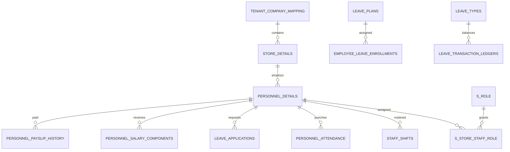

# Data model

> **Audience:** Backend developers, data engineers, architects, operators  
> **Purpose:** Describe the verified logical model and schema risks  
> **Last verified:** 2026-10-19  
> **Source of truth:** 38 JPA mappings and the 41-table MySQL 8 dump

## Domain map

## Core table groups

| Domain | Tables |
| --- | --- |
| Organization | `tenant_company_mapping`, `store_details`, `terminal_details`, `store_profile_config`, `store_holiday` |
| Staff | `personnel_details`, bank, document, emergency-contact, and work-experience child tables |
| Access | `access_modules`, `access_permissions`, `s_role`, `s_store_staff_role` |
| Shifts | `shift_slots`, `staff_shifts`, `day_wise_shifts_timing`, `break_types`, `staff_break_time`, `staff_booked_slots` |
| Attendance | `personnel_attendance`, `day_wise_attendance_summary`, `month_wise_attendance_summary`, `attendance_regularization_requests` |
| Leave | `leave_types`, `leave_plans`, `leave_plan_rules`, `employee_leave_enrollments`, `leave_applications`, logs, overrides, ledgers |
| Payroll | `salary_component_definitions`, `salary_component_rules`, `personnel_salary_components`, `personnel_payslip_history`, `payroll_scheduler_info` |

The dump has 41 tables: 38 are JPA-mapped and three are legacy Hibernate sequence tables.

## Tenant and location scoping

`tenant_company_mapping` is the root. Stores reference it, and staff records carry store and tenant-mapping references. Most operational tables repeat `tenant_id` and `store_id`. Leave records also use `location_id`.

`store_id = 0` is used as a global template convention for access modules and salary definitions in specific repository queries; it is not a universal rule for every table.

## Identifier rules

- API `staffId` should mean `personnel_details.id`.
- `employee_code` is the external/HR identifier.
- `personnel_code` is a legacy numeric value.

Current dump data and legacy columns sometimes mix these identities in fact-table `staff_id` fields. New integrations must map identifiers explicitly.

## Schema management

There are no versioned migrations. Development uses `spring.jpa.hibernate.ddl-auto=update`; partial SQL scripts and triggers live under backend resources but are not an automated migration chain.

Before production maturity:

1. establish a reviewed baseline migration;
2. version triggers and indexes;
3. use validation rather than automatic schema mutation;
4. define rollback and backup procedures.

## Verified schema mismatches

- `PersonnelDetails.salaryAmount` maps to `salaryAmount`, while the dump uses `salary_amount`.
- Several legacy `personnel_id`/`personnel_code` columns are not mapped.
- Staff identifier semantics vary in historical rows.
- Enrollment uniqueness annotations and table constraints are not fully aligned.
- Salary definitions include `absentPenalty` without a corresponding formula rule in the supplied dump.

These are documentation of current risk, not schema instructions. See [known limitations](../operations/known-limitations.md).
