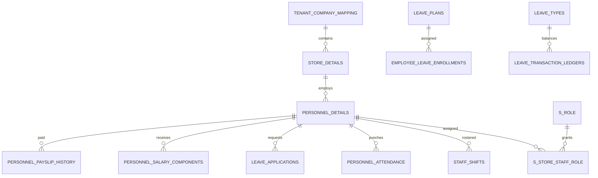

# Data model

> **Audience:** Backend developers, data engineers, architects, operators  
> **Purpose:** Describe the verified logical model and schema risks  
> **Last verified:** 2026-10-24  
> **Source of truth:** JPA mappings, Hibernate `ddl-auto=update`, and the original 41-table MySQL 8 dump

## Domain map

## Core table groups

| Domain | Tables |
| --- | --- |
| Organization | `tenant_company_mapping`, `store_details`, `terminal_details`, `store_profile_config`, `store_holiday` |
| Platform | `platform_user`, `platform_product`, `tenant_subscription`, `tenant_subscription_event`, `ops_support_session` |
| Staff | `personnel_details`, bank, document, emergency-contact, and work-experience child tables |
| Access | `access_modules`, `access_permissions`, `s_role`, `s_store_staff_role`, `staff_password_reset_otp`, `login_challenge` |
| Shifts | `shift_slots`, `staff_shifts`, `day_wise_shifts_timing`, `break_types`, `staff_break_time`, `staff_booked_slots` |
| Attendance | `personnel_attendance` (live regularization punches use `upload_source = REGULARIZATION`), `day_wise_attendance_summary`, `month_wise_attendance_summary`, `attendance_regularization_requests` (unused `/regularizations/*` path only) |
| Leave | `leave_types`, `leave_plans`, `leave_plan_rules`, `employee_leave_enrollments`, `leave_applications`, logs, overrides, ledgers |
| Payroll | `salary_component_definitions`, `salary_component_rules`, `personnel_salary_components`, `personnel_payslip_history`, `payroll_scheduler_info`, `pay_run`, `pay_run_skip`, `staff_loan`, `reimbursement_claim`, `it_declaration`, `salary_revision`, `scheduler_lock` |
| Hospitality | `staff_advance`, `commission_plan`, `commission_slab`, `staff_sales_entry`, `tip_pool_run`, `tip_pool_share`, `statutory_config`, `store_daily_sales`, `full_and_final_settlement` (also used by `/settlements`), `shift_swap_request`, `staff_availability` |
| Activity | `activity_log` (append-only; tenant/store, actor, module, action, resource, summary, redacted JSON context) |

`/settlements` and hospitality Full & final both persist `full_and_final_settlement`. Live punch corrections write `personnel_attendance`; `attendance_regularization_requests` is only for the unused `/regularizations/*` API. `scheduler_lock` prevents overlapping in-process jobs.

The dump has 41 tables: 38 are JPA-mapped and three are legacy Hibernate sequence tables. `activity_log` is an additional append-only table created by JPA (`ActivityLog`) plus `src/main/resources/sql/activity_log.sql`. Ops adds `platform_user`, `platform_product`, `tenant_subscription`, `tenant_subscription_event`, and `ops_support_session`. Those are not in the original dump. `tenant_company_mapping.product_id` points at `platform_product.id` (the suite the client came from). The catalog is operator-managed: code, display name, category (`BILLING`, `POS`, `HRIS`, `ATTENDANCE`, `OTHER`), origin (`FIRST_PARTY` or `THIRD_PARTY`), `integration_mode` (`STANDALONE` or `CONNECTOR`), and one `default_product` row. Superadmin can add more products without a code change. Seeded first-party rows are Devourin (default) and Respark. Payroll does not sync to any product yet. `tenant_subscription.sales_owner_id` points at `platform_user.id` (the salesperson who owns the client). `personnel_details.last_login_at` is written on successful client `/login` (not on a support-session handoff). Hibernate `ddl-auto=update` adds the columns. Existing tenants without a product are backfilled to the catalog default.

## Tenant and location scoping

`tenant_company_mapping` is the root. Stores reference it, and staff records carry store and tenant-mapping references. Most operational tables repeat `tenant_id` and `store_id`. Leave records also use `location_id`.

`store_id = 0` is used as a global template convention for access modules and salary definitions in specific repository queries; it is not a universal rule for every table.

## Identifier rules

- API `staffId` should mean `personnel_details.id`.
- `employee_code` is the external/HR identifier.
- `personnel_code` is a legacy numeric value.

Current dump data and legacy columns sometimes mix these identities in fact-table `staff_id` fields. Roster GET and staff-report SQL resolve `staff_shifts.staff_id` against both `personnel_details.id` and `personnel_code`, then expose canonical `id`. New writes should store `personnel_details.id`.

## Schema management

There are no versioned migrations. Development uses `spring.jpa.hibernate.ddl-auto=update`; partial SQL scripts and triggers live under backend resources but are not an automated migration chain.

Before production maturity:

1. establish a reviewed baseline migration;
2. version triggers and indexes;
3. use validation rather than automatic schema mutation;
4. define rollback and backup procedures.

## Verified schema mismatches

- `PersonnelDetails.salaryAmount` maps to `salaryAmount`, while the dump uses `salary_amount`.
- `PersonnelDetails.personnelCode` maps `personnel_details.personnel_code`. Other legacy `personnel_id`/`personnel_code` columns on fact tables remain unmapped.
- Staff identifier semantics vary in historical rows.
- Enrollment uniqueness annotations and table constraints are not fully aligned.
- Salary definitions include `absentPenalty` without a corresponding formula rule in the supplied dump.

These are documentation of current risk, not schema instructions. See [known limitations](../operations/known-limitations.md).
