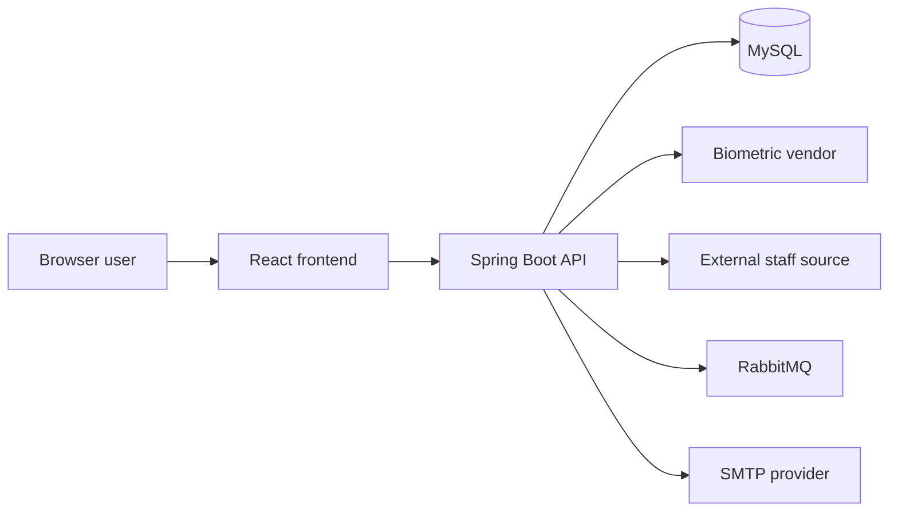
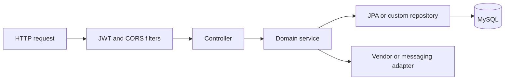

# System architecture

> **Audience:** Developers, architects, DevOps, technical clients  
> **Purpose:** Describe components, boundaries, and major data flows  
> **Last verified:** 2026-10-20  
> **Source of truth:** Both application repositories and MySQL schema

## Context

## Runtime components

| Component | Technology | Responsibility |
| --- | --- | --- |
| Frontend | React 18, Vite 4, React Router 5, TanStack Query 5, Sass modules, react-icons (Lucide) | UI, route visibility, session storage, API calls |
| Backend | Java 21, Spring Boot 3.3, Spring Security, JPA | Authentication, business rules, API, scheduling, integrations |
| Database | MySQL 8 | Operational records, summaries, ledgers, payroll history |
| Messaging | RabbitMQ | WhatsApp/notification payload publishing |
| Email | SMTP | Leave and regularization notifications |

## Frontend structure

`main.jsx` mounts provider layers in this order: Query Client, Theme, Toast, Auth, Router. `App.jsx` renders login or the authenticated shell and lazy-loads each feature screen. Theme defaults to light; Hajiro design tokens live in `src/styles/hajiro-theme.css` and `src/styles/main.scss` plus `Navigation` / `TopHeader` (248px sidebar, 88px mini rail, 64px header, 24px content gutters). Header chrome includes ⌘K command palette, approval notifications drawer, and account drawer (`src/components/shell/`).

Shared UI primitives live under `src/components/ui` (`Button`, `Input`, `Card`, `Badge`, `Modal`, `Drawer`, `Checkbox`, `Switch`, `Radio`). Screens should use these for overlays and binary/choice controls instead of raw browser checkboxes, radios, or ad-hoc SVG icons. Decorative and navigation icons use Lucide via `react-icons/lu`. Token names, shell sizes, `.mp-*` utilities, and styling rules are documented in [design system](design-system.md).

API calls use `/payroll-management/v1`. Vite proxies that path to backend HTTPS during development. JWT and login response data are stored in browser `localStorage`.

TanStack Query defaults to one-minute staleness, one retry, and refetch on focus. Some screens use shared hooks while others define inline queries/mutations.

## Backend structure

The backend is layered into controllers, services, repositories, JPA entities, DTOs/models, security, vendor handlers, and schedulers.

Most endpoints use `/payroll-management/v1`; external staff sync is under `/api/v1/sync`. Responses are not uniform: the service uses `LoginResponse`, `ResponseModel`, a response-handler envelope, raw objects/lists, maps, and binary files.

## Repository boundary

The frontend and backend are separate Git repositories. Documentation is stored in the frontend repository as the team-facing portal but is verified against both repositories. Backend behavior cannot be inferred from frontend visibility alone.

## Architectural constraints

- Tenant/store IDs occur throughout the schema and JWT, but there is no database row-level security.
- Schema changes currently rely on Hibernate `ddl-auto=update` plus manual SQL/triggers; there is no Flyway/Liquibase history.
- Business-critical scheduling runs in the application JVM.
- Attendance summarization combines database-trigger and application-service behavior.
- Salary formulas are data-configured MVEL expressions.

See [design system](design-system.md), [data model](data-model.md), [security and tenancy](security-and-tenancy.md), and [integrations](integrations.md).
