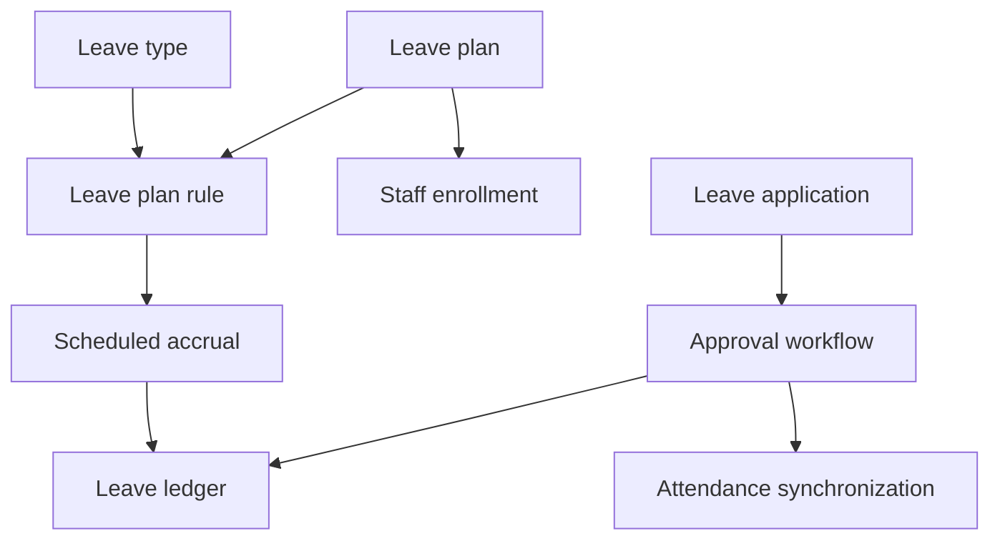

# Leave and holidays

> **Audience:** Employees, managers, HR, support, developers  
> **Purpose:** Explain leave policy, balances, requests, approvals, and holidays  
> **Last verified:** 2026-10-20  
> **Source of truth:** Leave screens/controllers/services/entities and scheduler

## Employee portal (`/leave-dashboard`)

Available to authenticated users. Employees can:

- see available balances and application history;
- apply for full-day or half-day leave;
- select an optional holiday where the leave type supports it;
- cancel or request cancellation of an application.

Apply, history, and cancel use the signed-in `staffId`. If that claim is missing, the form refuses to submit instead of acting as another employee. The apply API also rejects a body `staffId` that does not match the JWT unless the caller has `MANAGE_LEAVES`. Eligible-type lookup (`GET /leaves/types/{staffId}`) returns mapped type fields, not Hibernate entities.

Cancelling a **pending** leave completes immediately (`Leave cancelled successfully`). Cancelling an **approved** leave sets `CANCELLATION_REQUESTED` and waits for a manager. Weekly-off days stored as a comma-separated list are excluded from requested duration.

## Manager approvals (`/leave-approvals`)

Visible with `MANAGE_LEAVES`. Managers review pending applications and cancellation requests, then approve or reject them. The actor written to leave logs is the authenticated `staffId` from the JWT, not a client-supplied manager id.

`GET /leaves/applications/pending` returns store-wide work for `MANAGE_LEAVES`. HR metrics count both `PENDING` and `CANCELLATION_REQUESTED`.

## Leave configuration (`/leave-configuration`)

Requires `MANAGE_LEAVES` in both frontend and backend. It contains:

- leave types;
- leave plans;
- plan rules and accrual frequency;
- staff enrollment;
- balance adjustments;
- staff-specific rule overrides.

## Holiday calendar (`/settings/holidays`)

Requires `MANAGE_LEAVES` in the UI and for create/delete APIs. GET remains available to authenticated employees so optional-holiday leave can list store dates. The screen provides a month calendar (Monday-first) and a list view of store holidays, with create via a right-side Drawer. Page title comes from `TopHeader` only; the in-page chrome is a metrics row, calendar toolbar, and **Add holiday** action. Clicking a day opens the Drawer prefilled with that date. Delete is available from list view and from the Drawer when that day already has holidays. The month grid uses a single card shell with hairline cell dividers, primary-colored “today” marker, and badge-token event pills so light and dark themes stay readable.

## Balance model

Balances are derived from `leave_transaction_ledgers`, using allocation, accrual, debit, expiry, and adjustment entries.

## Scheduled accruals

- Monthly: first day of every month
- Quarterly: first day of January, April, July, and October
- Annual expiry/grant: first day of January

The exact entitlement comes from the assigned plan/rule and any override.

## Status lifecycle

`PENDING` → `APPROVED` or `REJECTED`; approved applications can move through `CANCELLATION_REQUESTED` to `CANCELLED`, or have cancellation rejected.

Leave reject and cancellation decisions require `MANAGE_LEAVES`. Type, history, and balance reads are self-or-`MANAGE_LEAVES`. See [security and tenancy](../architecture/security-and-tenancy.md).
