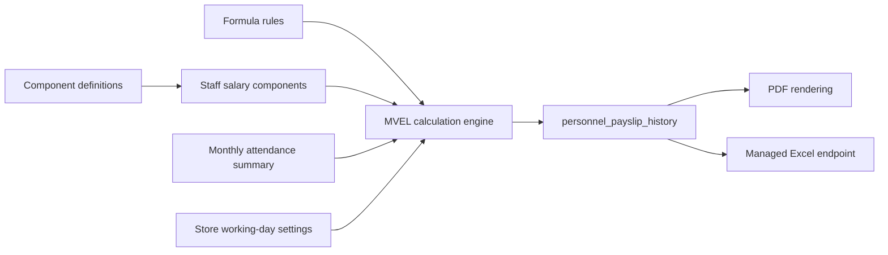

# Payroll and payslips

> **Audience:** Payroll administrators, HR, support, developers  
> **Purpose:** Describe salary configuration, calculation, and output  
> **Last verified:** 2026-10-20  
> **Source of truth:** Salary/Payslip screens, salary service, entities, and dump schema

## Salary Management (`/salary`)

Visible with `VIEW_SALARY` or `MANAGE_SALARY`. Write operations require `MANAGE_SALARY`.

The screen separates:

- **Configure Fixed Salary:** persistent per-person salary structure
- **Monthly Variables:** month/year-scoped additions or deductions. Load uses `GET /personnelSalaryComponentsForMonth`; save uses `POST /monthlyCalculationComponents` into `personnel_payslip_history`. Fixed save no longer deletes monthly-calculated rows, and component IDs are compared with `Objects.equals`.

Definitions can be earnings or deductions and fixed or formula-based. `priority_index` controls evaluation order. A definition scoped to `store_id = 0` is used as a tenant-level fallback where repository queries support it.

## Calculation pipeline

Formula context includes component aliases and attendance totals such as absent days, penalty days, late minutes, overtime, and extra days worked.

The code defaults to 30 working days per month and 9.5 hours per day when store/person settings do not override them.

## Payslips (`/payslips`)

Visible with `VIEW_SALARY` or `MANAGE_SALARY`. Users select a staff member and period, constrained by store payroll configuration (`recentSummaryCalculatedMonth` / `payrollLockedUpToDate`). The UI fetches historical payslip data and can print or download a generated PDF. The stored recent-month value is updated by vendor attendance retrieval, not by the on-demand month-summary trigger.

The backend also provides a permission-gated Excel endpoint, but the current Payslips screen does not expose an Excel action.

## Preconditions for a payroll month

1. Staff record and store/tenant assignment are correct.
2. Salary definitions and staff values exist.
3. Daily attendance is complete.
4. Monthly attendance summary has been calculated.
5. Formula aliases and rules are valid.
6. Payroll period is allowed by store lock settings.

## Important limitations

- Formula execution uses MVEL expressions controlled through database configuration; only trusted administrators should manage formulas.
- The dump contains `absentPenalty` definitions without corresponding formula-rule rows.
- The “Compliance Check Passed” UI badge is static.
- Payslip PDF requests currently infer a role ID from a string authority and may fall back to a fixed value.
- A payslip history row stores calculated JSON/amounts, not PDF file metadata.
