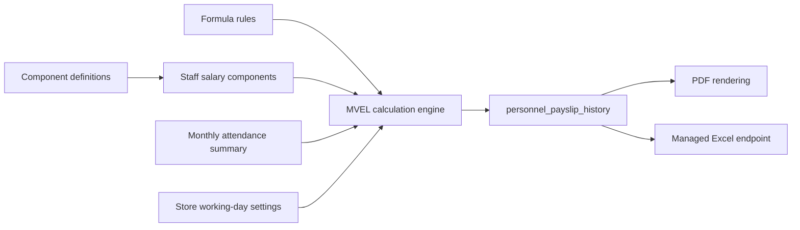

# Payroll and payslips

> **Audience:** Payroll administrators, HR, support, developers  
> **Purpose:** Describe salary configuration, calculation, and output  
> **Last verified:** 2026-10-24  
> **Source of truth:** Salary/Payslip screens, salary service, entities, and dump schema

## Salary Management (`/salary`)

Visible with `VIEW_SALARY` or `MANAGE_SALARY`. Write operations require `MANAGE_SALARY`.

The screen separates:

- **Configure Fixed Salary:** persistent per-person salary structure
- **Monthly Variables:** month/year-scoped additions or deductions. Month and year sit on the card header, not a separate period card. Load uses `GET /personnelSalaryComponentsForMonth`; save uses `POST /monthlyCalculationComponents` into `personnel_payslip_history`. Fixed save no longer deletes monthly-calculated rows, and component IDs are compared with `Objects.equals`. Saving monthly variables updates only those lines and totals; name, attendance, and bank fields on an existing payslip stay as they are.

The staff directory column is hidden when the signed-in user only has one person in the list (typical staff self-view). Self-view also falls back to the JWT `staffId` when the directory list is empty, so Salary and Payslips still load the signed-in person. Master-detail stays for managers who can pick among multiple staff. Blank earnings mean no `personnel_salary_components` row has been saved.

Definitions can be earnings or deductions and fixed or formula-based. `priority_index` controls evaluation order. A definition scoped to `store_id = 0` is used as a tenant-level fallback where repository queries support it.

## Calculation pipeline

Formula context includes component aliases and attendance totals such as absent days, penalty days, late minutes, overtime, and extra days worked.

The code defaults to 30 working days per month and 9.5 hours per day when store/person settings do not override them.

## Pay run (`/pay-run`)

Visible with `VIEW_SALARY` or `MANAGE_SALARY`. Writes require `MANAGE_SALARY`.

The screen is the existing pay-run engine, shown as a period workspace. It does not open a second calculator. A readiness list on the run tab shows opened → calculated → submitted → approved → published/locked.

1. Choose the month. `GET /payroll/runs?month=&year=` returns `UNOPENED` without inserting a row. **Open this period** (`POST /payroll/runs`, `MANAGE_SALARY`) creates the draft.
2. **Calculate** calls `SalaryCalculation.processSalary` for each active staff member who is not `skipPayroll` and not on the run skip list. Hospitality lines (`Hosp:`) are applied first, then core lines (`Core:`) for reimbursements, loan EMI, and statutory deductions.
3. **Submit → Approve → Publish → Lock**. Calculate and skip are blocked after approve. Publish sends WhatsApp payslip notifications. Lock writes `store_details.payrollLockedUpToDate`.

Other tabs: store statutory rates (same `statutory_config` row hospitality used), salary revision history, PF/ESI/PT/TDS worksheets and a Form 16 HTML worksheet (not a TRACES Form 16/24Q certificate), and payslip logo upload (stored as a data URI on `store_profile_config.logo_path`). Employer PF is a statutory/ECR cost. A tenant-named “Employer PF” deduction with `includeInTotal=true` is excluded from the Salary projected-net display.

Statutory eligibility is store policy **and** per-person flags on `personnel_details` (`pfApplicable`, `esiApplicable`, `ptApplicable`, `lwfApplicable`, `tdsApplicable`). Flags default on, so existing staff keep current behaviour.

## Claims, loans, settlements

| Route | Purpose |
| --- | --- |
| `/claims` | Employee reimbursements and IT declarations. New claims pick the pay month (default last month). Declarations choose Old or New regime. Approved claims become `Core:` earnings on that calculated month. Approved declarations reduce monthly TDS. Any authenticated user can open the route; managers with `MANAGE_SALARY` see the store queue. |
| `/loans` | First-class EMI loans, recovered during calculate from the chosen start month. Any signed-in user can see their own balance. Create/close need `MANAGE_SALARY`. Separate from hospitality advances. |
| `/settlements` | Full and final that closes core loans and marks the staff member inactive. Same `full_and_final_settlement` table as hospitality F&F. |
| `/reports/payroll` | Earnings, deductions, net, and headcount for a month. |

## Payslips (`/payslips`)

Visible with `VIEW_SALARY` or `MANAGE_SALARY`. Month, year, and **Generate** sit on the card header. The staff picker is only shown when the user can see other people. Shared period rules (`src/helpers/periodState.js`): **read** (Payslips) hides months after `recentSummaryCalculatedMonth` in the current year — locked months stay readable. **Write** (Monthly Variables) uses `payrollLockedUpToDate` only. `GET /getPayslipData` normalizes month names through `PayrollMonths.monthName()` and returns a distinct “no saved payslip” message. The UI fetches historical payslip data and shows a letterhead form: company name (logo only when `logo_path` is set), pay period, employee, attendance, earnings against deductions, and net payable in figures and words. Download PDF renders the same fields from `paySlip.vm`. Amounts are two-decimal Indian rupees. Bank, PAN, UAN, and IFSC appear only when stored. Paid leave uses `totalPaidLeaves`, not holidays. After a salary run, hospitality lines (`Hosp: `) can be added for overtime, commission, service-charge share, advance recovery, and statutory deductions. See [hospitality payroll](hospitality-payroll.md). `recent_summary_calculated_month` advances only after month-wise attendance summary rows are saved (scheduled retrieve or on-demand `POST /trigger/calculateMonthWiseSummary`) for the current year. Home pay month reads the latest `personnel_payslip_history` row (month + year), not the attendance cursor.

The Payslips screen exposes PDF for salary viewers and Excel for `MANAGE_SALARY`. Logo upload lives on Pay run.

## Preconditions for a payroll month

1. Staff record and store/tenant assignment are correct.
2. Salary definitions and staff values exist.
3. Daily attendance is complete.
4. Monthly attendance summary has been calculated.
5. Formula aliases and rules are valid.
6. Payroll period is allowed by store lock settings.

## Important limitations

- Formula execution uses MVEL expressions controlled through database configuration; only trusted administrators should manage formulas.
- The dump contains `absentPenalty` definitions without corresponding formula-rule rows.
- Payslip PDF requests currently infer a role ID from a string authority and may fall back to a fixed value.
- A payslip history row stores calculated JSON/amounts, not PDF file metadata.
