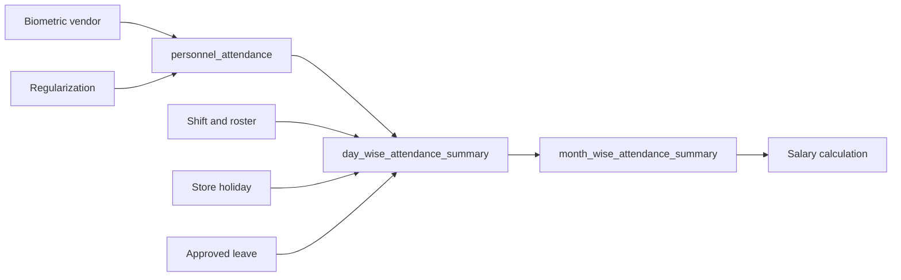

# Shifts and attendance

> **Audience:** Employees, managers, HR, support, developers  
> **Purpose:** Describe roster, punch, summary, and regularization flows  
> **Last verified:** 2026-10-20  
> **Source of truth:** Shift/attendance screens, services, entities, and scheduler

## Shift Management (`/shifts`)

The route and navigation are visible with `VIEW_SHIFTS` or `MANAGE_SHIFTS`. Backend GET shift/slot/weekly endpoints allow either authority; POST roster/slots still require `MANAGE_SHIFTS`. `GET /staffshifts?date=` and weekly store roster both select from `staff_shifts` by tenant, store, and `shift_date` (no personnel-table join). Returned `staffId` values are canonical `personnel_details.id`; rows stored under `personnel_code` are remapped on read.

Implemented tabs:

- **Shift Management:** reusable shift templates and time rules
- **Roster Management:** staff/date assignments (`shiftDate` is sent as `yyyy-MM-dd`)
- **Weekly Schedule:** store-level weekly view
- **Store Hours:** open/close times for roster dropdowns (`MANAGE_SHIFTS` only)

Only users with `MANAGE_SHIFTS` see write controls. Regularization approval listing maps remark/status/punch event from the current SQL column order. Pending/rejected punches are shown on the day but do not count as Present.

## Attendance (`/attendance`)

All authenticated users can reach the route. The screen provides:

- month/year calendar;
- daily punch and calculated status;
- own leave summary;
- regularization and leave shortcuts;
- staff selector when `VIEW_OTHER_STAFF` is available.

Display codes include present, absent, half day, late, weekly off, and public holiday. The calendar posts `staffIds: [selectedStaff]`; the in/out history APIs reject an empty staff list with HTTP 400.

## Attendance data flow

Terminal inserts also invoke a database trigger that updates portions of the daily summary. Application services calculate richer classifications and monthly summaries.

## Regularization

Employees submit corrections from the attendance modal. Users with `MANAGE_ATTENDANCE` can create an immediately approved correction in that modal.

Regularization Approvals (`/approvals`) requires `MANAGE_ATTENDANCE` in the UI and supports pending, approved, and rejected queues through legacy attendance endpoints. A second newer `/regularizations/*` API also exists, so integrations must not assume there is only one contract.

## Scheduled retrieval

The attendance scheduler scans `payroll_scheduler_info` on a fixed delay. The default is 1,200,000 ms, which is 20 minutes. It selects `ATTENDANCEDATAREMINDER` rows whose invocation time is between one hour ago and 100 minutes ahead. A successful vendor pull moves each selected row forward by one day. A failed pull leaves the invocation time unchanged.

## Operational cautions

- Stable employee-code mapping is required for biometric imports.
- Timezone is stored per store; JPA uses `Asia/Kolkata` as the configured JDBC timezone.
- Attendance retrieval, daily summary, monthly summary, and payroll are separate stages.
- A failed retrieval older than the one-hour lookback stays stuck until an operator moves its invocation time back into that window. See [known limitations](../operations/known-limitations.md).
