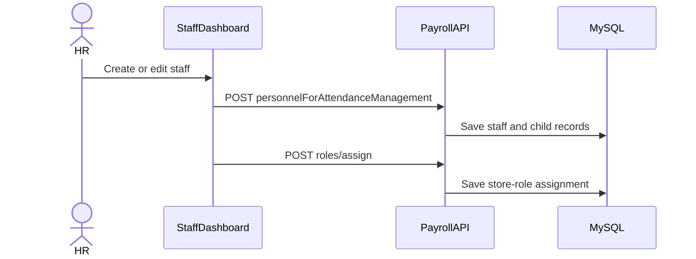

# Staff and roles

> **Audience:** HR users, managers, support, developers  
> **Purpose:** Explain staff records and role assignment  
> **Last verified:** 2026-10-20  
> **Source of truth:** `StaffDashboard`, `RoleManagement`, staff/role controllers

## Staff Details (`/staff`)

The authenticated landing page is the Staff Details screen. Users without broader staff access are automatically scoped toward their own record. The directory is searchable. Reporting manager uses the shared staff picker. Removing a document or experience asks for confirmation before it leaves the form.

The editor groups data into:

1. Personal & Access
2. Joining & Employment
3. Banking & Documents
4. Work Experience

Employment also stores hospitality pay fields: pay cycle, employment type, job codes, overtime multiplier, ESI number, and PAN.

`MANAGE_STAFF` enables create/edit controls and the full store directory. `VIEW_OTHER_STAFF` also enables the directory without write access. Empty joining `Long` fields are sent as `null` on save. After create, child bank/document rows receive the saved staff id.

### Save flow

The frontend sends the staff save before role assignment. A valid role/store link in `s_store_staff_role` is required for expected authorities at login.

## Roles & Permissions (`/roles`)

Requires `MANAGE_ROLES` in the UI and backend controller.

Administrators can:

- create and update tenant roles;
- select permission IDs grouped by access module;
- assign a role to a staff member at a store;
- inspect a staff member's assigned role.

Role permissions are persisted as comma-separated strings. At login the backend emits both `ROLE_<ROLE_NAME>` and each permission string as authorities.

## External staff import

The backend can import roles and staff from a configured external system. Imported roles start with no permissions and need administrative review. New users are created with an implementation default credential; operators must require a secure reset before access.

See [integrations](../architecture/integrations.md).

## Known behavior

- `MANAGE_STAFF` can display directory controls while the common staff query still limits results unless `VIEW_OTHER_STAFF` is present.
- Staff ID, employee code, and legacy personnel code are distinct identifiers.
- The backend has authenticated staff write and password-update endpoints without complete method-level permission enforcement. Do not rely only on hidden UI controls.
