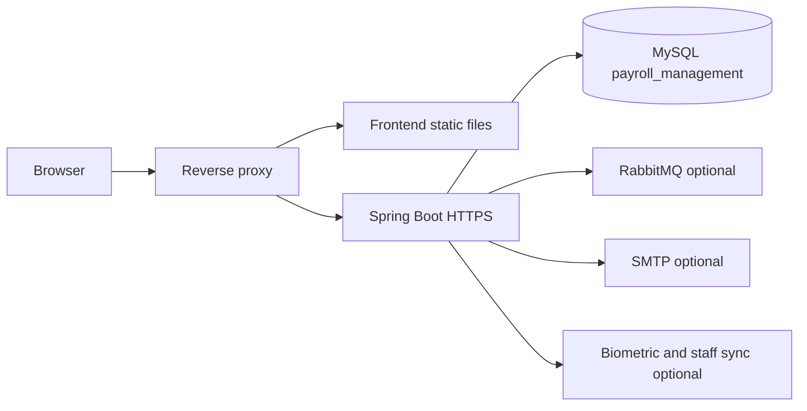

# QA and production deployment

> **Audience:** QA, DevOps, developers, implementation, support  
> **Purpose:** Deploy and verify the payroll UI and API on a shared QA server and on production without copying secrets into Git  
> **Last verified:** 2026-10-20  
> **Source of truth:** Current frontend build, backend `application.properties`, `SecurityConfig`, and verified local runtime

This page is the briefing for other team members. Local laptop setup stays on [local development](local-development.md). Secrets handling stays on [configuration](../reference/configuration.md). Gaps that must not be promised as complete are on [known limitations](known-limitations.md).

There is no Dockerfile or CI pipeline in these repositories today. Operators package the two artifacts below and run them behind a reverse proxy.

## What to tell the team

1. **Two repositories deploy together.** `payroll-frontend` is the React UI. `payroll-backend` is the Spring Boot API. They stay separate Git repos. Ship matching commits; do not mix an old API with a new UI when contracts changed.
2. **Secrets never go in Git.** Tracked `application.properties` only has placeholders. QA and production inject values from a secret store or environment variables. Do not copy a developer `application-local.properties` onto a server.
3. **Rotate previously leaked values.** Database, JWT, SSL, mail, and broker secrets that once sat in source must be replaced in every environment that used them.
4. **Same-origin proxy is the supported browser pattern.** The UI calls `/payroll-management/v1` on the page origin. Vite does that only in `npm run dev`. QA and production must reverse-proxy that path to the API.
5. **QA tests roles, not only screens.** Navigation hiding is not security. Staff users must be forbidden from other people’s payslips, leave, attendance, and the staff directory. Admins must still complete roster, reports, leave approval, and payroll flows.
6. **Schedulers run inside the API process.** A database lock skips overlapping copies of the same job. Still run **one** API instance per environment as the normal topology.
7. **Hibernate can change the database.** Default `ddl-auto` is `update`. Use a disposable or backed-up QA database. Production should move to `validate` or `none` after a reviewed baseline.

## Runtime shape



| Piece | Artifact | Process |
| --- | --- | --- |
| UI | `payroll-frontend` `dist/` from `npm run build` | Static files plus SPA fallback to `index.html` |
| API | `payroll-backend` executable JAR from `mvn package` | Java 21, HTTPS, default port 8092 |
| Data | MySQL 8 schema `payroll_management` | One database per environment |
| TLS | JKS keystore for the API (`classpath:keystore.jks`) plus proxy certificates | Passwords injected, files not in Git |

Optional at deploy time: RabbitMQ (password-reset OTP), SMTP (leave/regularization mail), biometric vendor, external staff sync. Login and most screens work without them.

## Secrets and configuration

Do not put real values in this portal, tickets, screenshots, or chat. Store them in the environment secret manager and inject at process start.

| Name | Required to boot | Notes |
| --- | --- | --- |
| `SPRING_DATASOURCE_URL` | Yes | Full JDBC URL to that environment’s MySQL |
| `DB_USERNAME` | Yes | Database account with rights only on this database |
| `DB_PASSWORD` | Yes | Injected secret |
| `JWT_SECRET` | Yes | HS256 key, **at least 32 bytes**. Distinct per environment. Missing or short value fails startup |
| `JWT_EXPIRATION_MS` | No | Default ten hours |
| `SSL_KEY_STORE_PASSWORD` | Yes while HTTPS keystore is enabled | Must match the JKS on the server |
| `SSL_TRUST_STORE_PASSWORD` | Yes while the trust store is set | |
| `SSL_KEY_ALIAS` | If the alias is not the committed default | |
| `CORS_ALLOWED_ORIGINS` | If UI origin differs from the API | Comma-separated browser origins. Leave unset when the reverse proxy is same-origin |
| `HIBERNATE_DDL_AUTO` | Strongly set | `update` only on disposable QA; `validate` or `none` for production |
| `RABBITMQ_*` | For OTP WhatsApp | Separate QA vs production broker/queue |
| `MAIL_*` | For email notifications | Separate QA mailbox |
| `APP_ENV`, `ADDRESS_QUEUE` | If using the address queue | Do not share production queues with QA |

The gitignored local file `application-local.properties` is **developer-only**. QA and production use environment injection, not that file.

The API keystore is gitignored (`*.jks`). Place the environment keystore where the process can load `classpath:keystore.jks`, or change the keystore location through Spring properties without committing the file.

Vendor and biometric credentials live in tenant/store **database** rows. Treat those as secrets too. Restore only sanctioned QA data; never restore production rows to QA.

## Build artifacts

From a clean checkout of the commits you intend to ship:

```bash
# Frontend static bundle
cd payroll-frontend
npm ci
npm run docs:check
npm run build
# output: dist/

# Backend executable JAR
cd payroll-backend
export JAVA_HOME='<path-to-java-21>'
mvn -DskipTests package
# output: target/payroll-service-0.0.1-SNAPSHOT.jar
```

Run `mvn test` on the backend when the change can break leave, security, or salary. Coverage is thin; a green suite is not a release certificate.

The UI bundle has **no API host setting**. It always calls `/payroll-management/v1`. If the reverse proxy is missing, the browser talks to the UI host and login fails.

## Reverse proxy (required)

Serve the UI and API on **one public origin** so the browser never needs CORS.

Synthetic layout (replace host, ports, and certificate paths with values from the secret manager, not from this page):

```nginx
server {
    listen 443 ssl;
    server_name <qa-or-prod-host>;

    ssl_certificate     <public-cert>;
    ssl_certificate_key <private-key>;

    root /var/www/payroll-frontend/dist;
    index index.html;

    location /payroll-management/v1/ {
        proxy_pass https://127.0.0.1:8092;
        proxy_ssl_verify off;          # only if the API uses a private/self-signed cert
        proxy_set_header Host $host;
        proxy_set_header Authorization $http_authorization;
        proxy_set_header X-Forwarded-Proto $scheme;
        proxy_set_header X-Forwarded-For $proxy_add_x_forwarded_for;
    }

    location /actuator/health {
        proxy_pass https://127.0.0.1:8092;
        proxy_ssl_verify off;
    }

    location / {
        try_files $uri $uri/ /index.html;
    }
}
```

`try_files ... /index.html` is required. Direct opens of `/staff`, `/attendance`, `/reports` otherwise 404.

If someone must open the API on a **different origin** than the UI, set `CORS_ALLOWED_ORIGINS` to that UI origin and restart the API. Prefer the proxy instead of growing that list. Do not record real QA or production hostnames in Git.

## QA server procedure

Use a dedicated QA database and a dedicated `JWT_SECRET`. Do not point QA at production MySQL.

1. **Prepare MySQL.** Create `payroll_management` (or the agreed QA name). Restore a **sanitized** baseline. Take a backup before the first API start because `ddl-auto=update` can alter schema.
2. **Place the API keystore** and inject `SSL_KEY_STORE_PASSWORD` / `SSL_TRUST_STORE_PASSWORD`.
3. **Inject environment variables** listed above. Generate a new QA `JWT_SECRET`; do not reuse a developer laptop value.
4. **Start one API process:**

```bash
export JAVA_HOME='<path-to-java-21>'
export SPRING_DATASOURCE_URL='jdbc:mysql://<qa-db-host>:3306/payroll_management?useSSL=true&requireSSL=true'
export DB_USERNAME='<qa-db-user>'
export DB_PASSWORD='<qa-db-secret>'
export JWT_SECRET='<qa-jwt-secret-at-least-32-bytes>'
export SSL_KEY_STORE_PASSWORD='<qa-keystore-secret>'
export SSL_TRUST_STORE_PASSWORD='<qa-keystore-secret>'
export HIBERNATE_DDL_AUTO=update

java -jar payroll-service-0.0.1-SNAPSHOT.jar
```

5. **Confirm boot.** Logs show `Started PayrollManagementApplication`. `GET /actuator/health` through the proxy returns `{"status":"UP"}`. Other `/actuator/*` paths must not be public.
6. **Publish `dist/`** behind the proxy with SPA fallback.
7. **Smoke login** with the approved QA accounts (stored in the team password manager, not in this portal).
8. **Optional integrations.** Configure RabbitMQ/SMTP/vendor rows only when QA is meant to exercise those flows. Otherwise document them as out of scope for that build.

### QA accounts and data

- Keep usernames and passwords in the password manager.
- Provide at least two roles on the same QA tenant/store:
  - **Staff:** `VIEW_STAFF`, `VIEW_ATTENDANCE`, `VIEW_SALARY` (no manage permissions).
  - **Admin / HR:** the manage set used in [routes and permissions](../reference/routes-and-permissions.md) (`MANAGE_STAFF`, `MANAGE_LEAVES`, `MANAGE_ATTENDANCE`, `MANAGE_SALARY`, `MANAGE_SHIFTS`, `VIEW_REPORTS`, `VIEW_HR_DASHBOARD`, and so on).
- Staff must be `active` and have an active `s_store_staff_role`. Inactive users get the same login failure as a wrong password.
- Never seed production people, bank, or salary rows into QA.

### QA acceptance checklist

Sign in as **staff**, then as **admin**, and confirm both UI and network tab.

**Staff must**

- See a flat sidebar (no accordion groups) in this order: Home, Attendance, My Work, then My Leaves, Salary, and Payslips, with Profile at the bottom.
- Land on `/home` after sign-in and see their own shift, leave balances, and shortcuts.
- Open `/staff` and see **only their own** profile, including assigned role name, in read-only mode.
- Open `/attendance` for themselves; month calendar loads.
- Open `/salary` or `/payslips` only for themselves; another `staffId` in the API returns **403**.
- Apply leave for themselves; applying with another `staffId` returns **403**.
- Be redirected from `/reports`, `/roles`, `/leave-approvals` to `/home`. `/hr-dashboard` also opens Home.
- Receive **403** (not logout) on forbidden APIs. Only **401** clears the session.

**Admin must**

- See the full directory on `/staff` and create/edit when they have `MANAGE_STAFF`.
- Load weekly roster and attendance summary **by staff name** (roster `staff_id` may historically be `personnel_code`; the API remaps to `personnel_details.id`).
- Approve/reject leave and regularization.
- Create/delete holidays with `MANAGE_LEAVES`.
- Run payroll calculation and open another staff member’s payslip.
- Open `/reports` and generate the current-month summary.

**Platform checks**

- `/login` works over the public HTTPS origin.
- Client routes reload without 404.
- The forgot-password start step still returns a generic success message for unknown identifiers; OTP delivery needs RabbitMQ.
- Reset password rejects values shorter than 8 characters.
- Health is public; Prometheus or other actuator routes are not.
- Logs contain no passwords, JWTs, or OTPs.

Failed items are bugs or environment mistakes. Do not waive a 403 failure for staff as “UI-only.”

## Production procedure

Production is the QA procedure plus stricter controls. Do not treat a successful QA demo as production certification. See [required production posture](../architecture/security-and-tenancy.md#required-production-posture).

1. **Freeze the pair of Git SHAs** for frontend and backend. Build from those SHAs only.
2. **Take a database backup** before the new JAR starts. There is no Flyway/Liquibase history.
3. **Set `HIBERNATE_DDL_AUTO=validate` or `none`.** Do not let production boot mutate schema. Apply reviewed DDL separately.
4. **Inject production secrets** from the secret manager. Use a **new** `JWT_SECRET` if the previous value ever existed in source. Changing the JWT secret signs everyone out.
5. **TLS.** Terminate public HTTPS on the proxy with a trusted certificate. The API may keep its JKS for loopback, or the team may put a trusted cert there; do not commit either file.
6. **Prefer one API JVM.** Schedulers take a database lock, but overlapping instances are still not the intended topology.
7. **Restrict network.** Database, RabbitMQ, and SMTP are private. Trigger and sync endpoints require `MANAGE_*` authorities, not a generic JWT.
8. **CORS.** Keep the public UI on the same origin as the proxy. Do not enable credentialed CORS for unknown origins.
9. **Roll forward with a rollback plan:** keep the previous JAR, previous `dist/`, and the pre-deploy dump. To roll back, stop the process, restore files (and database if schema changed), start the previous JAR.
10. **Post-deploy smoke:** health UP, admin login, staff login, one leave read, one attendance read, one payslip read, one report generate. Then watch `logs/payroll-service.log` for scheduler or JDBC errors.

Production schema, salary, and attendance data must never appear in this portal.

## After deploy: what operations watch

| Signal | Expected |
| --- | --- |
| `/actuator/health` | `UP` |
| API log | `Started PayrollManagementApplication`; no repeated JDBC or keystore errors |
| Scheduler | Attendance reminder and leave accrual run once per environment, not once per extra replica |
| Disk | `logs/payroll-service.log` rotates or is shipped; do not commit `logs/` |
| Browser | 401 on expired JWT returns to `/login`; 403 shows a permission toast |

## What not to do

- Commit `application-local.properties`, `.jks`, dumps, or `.env` files.
- Reuse local or QA `JWT_SECRET` in production.
- Start the API without `JWT_SECRET`.
- Run `npm run dev` as the QA or production UI.
- Point two environments at one database.
- Promise biometric, OTP, or email in a release unless that environment’s optional services are configured and tested.
- Treat Hibernate `update` as a migration process.

## Related pages

- [Local development](local-development.md)
- [Configuration reference](../reference/configuration.md)
- [Tenant onboarding](tenant-onboarding.md)
- [Runbook and troubleshooting](runbook-and-troubleshooting.md)
- [Routes and permissions](../reference/routes-and-permissions.md)
- [API reference](../reference/api-reference.md)
- [Known limitations](known-limitations.md)
- Backend startup: `payroll-backend` repository `docs/getting-started.md`
