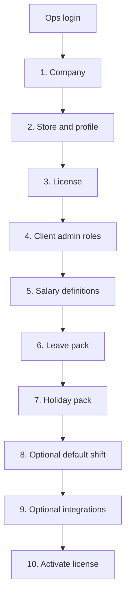

# Tenant onboarding

> **Audience:** Implementation engineers, operators, support  
> **Purpose:** Provision a tenant through the internal ops console without copying SQL  
> **Last verified:** 2026-10-24  
> **Source of truth:** `/ops` wizard, `OpsOnboardingService`, `OpsSalaryPackService`

## Principles

- Use `/ops`, not laptop SQL, for a new client.
- Never copy IDs from another tenant. The wizard generates `tenantId` and `storeId`.
- Never place vendor, database, or user passwords in this portal.
- Client HR still finishes staff, roster, leave enrollment, and salary amounts after the admin can sign in.
- Platform users (`superadmin`, `sales`) never receive a client JWT except a 30-minute superadmin support session. That session opens through a one-time handoff in a new tab and is written to the activity log.

## Provisioning order

## 1. Company

Create `tenant_company_mapping`: name, source product (`tenant_company_mapping.product_id` from the `platform_product` catalog, default unless the operator picks another), salary-cycle start day, summary/salary offsets, paid-leave flag. Superadmin can add more suites later. Payroll stays standalone. Do not treat the product as a live connector.

## 2. Store and profile

Create `store_details` (timezone, hours, FY start, lock date, currency, attendance mode) and `store_profile_config` (company/address, working days/hours).

## 3. License

Write `tenant_subscription`: `DRAFT`, `TRIAL`, `ACTIVE`, `SUSPENDED`, or `EXPIRED`; dates; plan `STANDARD` or `HOSPITALITY`; store/staff caps; module flags; `sales_owner_id` (defaults to the operator who created the tenant). Draft tenants cannot use client `/login`.

## 4. Client admin

Create tenant-scoped Admin, Manager, and Staff roles in `s_role` (not the hidden platform roles). Create the root `personnel_details` user and `s_store_staff_role`. Show the temp password once. Ops marks **First admin signed in** after that user completes client `/login`. Support sessions do not count.

## 5. Salary definitions

The client Salary screen cannot create definitions. Ops applies a system pack, or a superadmin adds, edits, or deletes `salary_component_definitions` and MVEL `salary_component_rules`. The wizard and client record can clone salary, leave, letterhead, and holidays from another tenant the operator can see. Clone-from skips aliases that already exist on the target and only fills blank letterhead fields. Formula preview uses sample inputs. Aliases such as `basic` and `hra` are what `SalaryCalculation` evaluates. Use `store_id = 0` for tenant-global rows. Do not duplicate the same alias on store `0` and a store-specific row. FORMULA rows are marked computable so monthly payroll can evaluate them.

## 6. Leave pack

Creates CL, SL, EL, OH and one default plan with annual rules. HR enrolls staff later on `/leave-configuration`.

## 7. Holiday pack

Writes fixed national holidays for the selected year (New Year, Republic Day, Labour Day, Independence Day, Gandhi Jayanti, Christmas). Variable festival dates stay a client HR step on `/settings/holidays`. Clone-from also copies existing `store_holiday` rows.

## 8. Optional default shift

Creates one General `shift_slots` row from store hours.

## 9. Optional integrations

Team Office vendor fields, terminals, `ATTENDANCEDATAREMINDER`, and external staff-sync URLs. Hospitality plans persist `statutory_config`. The live client record can change these after go-live.

## 10. Activate

Set the subscription to `TRIAL` or `ACTIVE`. Then sign in at `/login` as the client admin and complete the [acceptance checklist](#acceptance-checklist).

## Acceptance checklist

- Platform user cannot open `/home`
- Client admin cannot open `/ops`
- Login produces correct tenant/store claims and role authorities
- User cannot see another tenant/store
- Salary definitions appear on `/salary` so HR can type amounts
- Leave configuration shows the default plan
- Shift Management shows the General slot when created
- Expired or suspended license blocks client login
- Scheduler, logs, retries, backups, and monitoring are owned

## Assisted lifecycle (not self-serve)

Onboarding is operator-assisted. RelFor does not sell itself: there is no public signup, in-app billing, or live POS connector. Ops provisions the tenant, the client admin signs in, and HR finishes staff, roster, leave, and salary amounts. Treat hospitality clock, advances, service charge, and NEFT as existing modules, not expansion work. Statutory worksheets stay in-product; government filing stays outside.

Record tenant ID, store IDs, implementation version, and acceptance evidence in the deployment system—not in this public repository.
