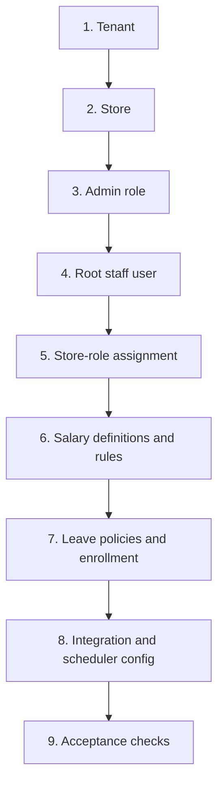

# Tenant onboarding

> **Audience:** Implementation engineers, operators, support  
> **Purpose:** Safely provision a tenant without copying stale hardcoded SQL  
> **Last verified:** 2026-10-19  
> **Source of truth:** Current entities, services, startup seeder, and schema

## Principles

- Perform onboarding in a controlled environment with a backup and change record.
- Use generated IDs and parameterized, idempotent scripts; never copy IDs from another tenant.
- Never place vendor, database, or user passwords in documentation.
- Validate every relationship before enabling user access.
- Prefer a versioned onboarding tool/migration over manual SQL. The current application does not yet provide one.

## Provisioning order

## 1. Tenant

Create a `tenant_company_mapping` record with unique tenant identity, application name, salary-cycle settings, and leave behavior. Configure integration fields only when approved endpoints and secrets are available.

## 2. Store

Create at least one `store_details` record linked to the tenant. Confirm:

- business timezone;
- open/close time;
- financial-year start;
- payroll lock;
- currency and date display;
- external branch ID where staff sync is used.

## 3. Administrative role

Create a tenant-scoped active role. Select the minimum permissions needed for onboarding and administration. Do not treat an old comma-separated “all permissions” example as canonical; compare with the current [permission matrix](../reference/routes-and-permissions.md).

## 4. Root staff user

Create a staff record with a unique username/email, BCrypt password, tenant/store relationship, employee code, and active state. Require password rotation through a secure channel.

## 5. Store-role assignment

Create `s_store_staff_role` linking the staff primary key, role, tenant, and store. Verify authorities by logging in and inspecting expected navigation and API access.

## 6. Salary setup

Create component definitions and formula rules for the tenant/store. Validate alias uniqueness, priority order, earning/deduction category, fixed/formula type, and global (`store_id = 0`) intent. Run a worked salary example before assigning live values.

## 7. Leave setup

Create leave types, plans, rules, staff enrollment, and opening allocations. Verify accrual frequency, carry-forward, half-day, proof, and cancellation behavior.

## 8. Integrations and scheduler

- Biometric: tenant vendor configuration plus `payroll_scheduler_info` event `ATTENDANCEDATAREMINDER`
- Staff import: tenant external URL/app name plus store external branch ID
- Notifications: environment-specific RabbitMQ and SMTP configuration

Test integrations with synthetic users before production data.

## 9. Acceptance checklist

- Login produces correct tenant/store claims and role authorities
- User cannot see another tenant/store
- Staff self/manager visibility matches policy
- Shift and attendance calculations match a sample week
- Leave balance and approval produce expected ledger entries
- Monthly attendance summary reconciles to source days
- Salary components and formulas match approved examples
- Payslip totals and exports reconcile
- Scheduler, logs, retries, backups, and monitoring are owned

Record tenant ID, store IDs, implementation version, approvers, and acceptance evidence in the deployment system—not in this public repository.
