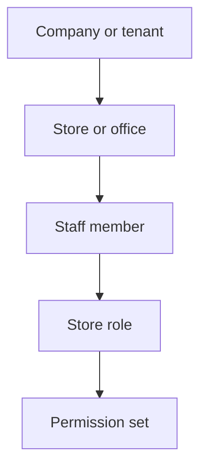
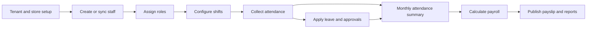

# Product overview

> **Audience:** Clients, stakeholders, product, sales, implementation teams  
> **Purpose:** Describe the verified product scope without implementation detail  
> **Last verified:** 2026-10-24  
> **Source of truth:** Frontend screens/routes and backend controllers/services

## What Relfor Payroll does

Relfor Payroll is a multi-tenant workforce and payroll application for organizations operating one or more stores or offices. It combines employee records, role-based access, shifts, attendance, leave, salary configuration, payslips, and reporting in one authenticated application. The web UI uses a light-first Hajiro shell (navy / blue / teal tokens, custom Sass + Lucide icons). Product name and logo stay as they are.

The hierarchy is:

## Implemented modules

| Module | Verified capabilities |
| --- | --- |
| Authentication | Username/email login, JWT session, password-reset OTP flow |
| Home | Permission-composed landing: staff day (clock, leave, payslip) or operations queues plus HR metrics |
| Activity log | Append-only store history of sign-in, staff, roles, leave, attendance, roster, payroll, and hospitality mutations |
| Staff | Store staff directory, employee profile, employment details, bank/documents, work experience |
| Roles | Custom roles, permission selection, staff role assignment |
| Shifts | Shift templates, roster assignment, weekly schedule |
| Attendance | Monthly calendar, punch details, manual regularization, approval queue |
| Leave | Leave types/plans/rules, enrollment, balance ledger, requests, approvals, cancellation, holidays |
| Payroll | Fixed and monthly components, formula-based components, attendance-aware monthly calculation, pay-run workflow, first-class statutory lines, reimbursements, IT declarations, loans, settlements |
| Payslips | Historical payslip data, printable view, PDF and Excel download, store logo upload |
| Reporting | Attendance summary, CSV export, staff detail, payroll cost, executive HR metrics |
| Hospitality | Advances, commission slabs, staff sales import, service-charge pool, statutory payslip lines, labor vs sales, F&F, muster/NEFT, employee clock and shift swap |
| Integrations | Team Office biometric retrieval, external role/staff import, RabbitMQ notifications, SMTP email |

## Primary personas

- **Employee:** views own profile, attendance, leave balances, applications, and permitted payslips.
- **Manager:** reviews attendance regularization and leave requests when granted management permissions.
- **HR administrator:** maintains staff, roles, shifts, policies, holidays, and HR dashboard data.
- **Payroll administrator:** configures salary components, runs payroll operations, and accesses payroll reports.
- **Tenant implementation/operator:** signs in at `/ops` as a platform `superadmin` or `sales` user, assigns a source product from the catalog, provisions tenant/store data, licenses, letterhead, holiday and salary packs, and (superadmin) maintains the product catalog and a 30-minute support session. Payroll stays standalone until a connector exists.

Access is permission-driven, not persona-driven: a role is a named bundle of authority strings. See [routes and permissions](../reference/routes-and-permissions.md).

## Product boundaries

The current application is not a complete accounting, benefits, recruiting, performance-management, billing, or statutory filing suite. India PF/ESI/PT/TDS/LWF/NEFT lines are product cues, not proof of statutory certification. Form 16 HTML is a payroll worksheet, not a TRACES certificate. Compliance badges visible in parts of the UI are static labels; they are not evidence of automated legal validation. Customer lifecycle is assisted through `/ops` — no self-serve signup or live POS connector.

Multi-tenancy exists at the data and JWT-claim level, but some endpoints still need stronger ownership enforcement. Client commitments must account for the [known limitations](../operations/known-limitations.md).

## Typical lifecycle

## Deployment shape

The verified development topology is a React single-page application, a Java 21 Spring Boot API, and MySQL 8. HTTPS is enabled on the backend. RabbitMQ, SMTP, biometric APIs, and external staff sources are optional dependencies for the features that use them.
